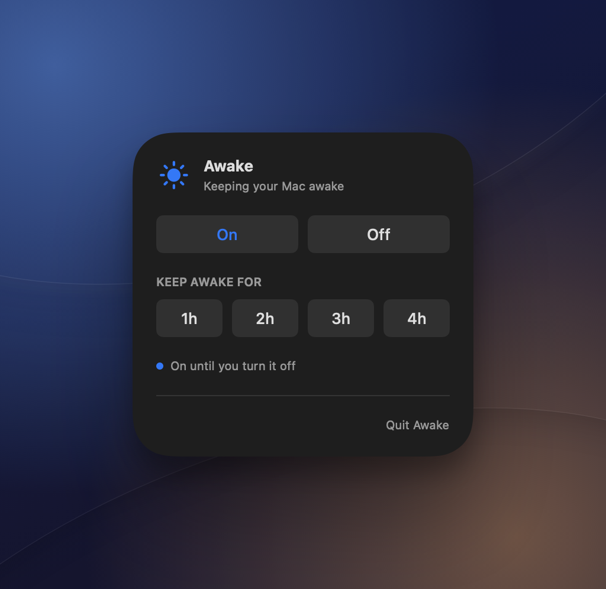

# Awake

[](https://github.com/PAAparaschivei/awake/actions/workflows/ci.yml)

Awake is a macOS menu bar app that prevents idle system sleep. Turn it on while a long task runs or choose a timer from one to four hours.

<a href="docs/awake.png"></a>

Click the moon in the menu bar to open the controls. Choose **On**, a duration or **Off**. The icon becomes a sun during a session. Awake starts inactive each time.

The Mac can still dim or lock its display. Lid closure and manual sleep follow macOS's normal behavior. Awake uses the built-in `caffeinate` utility and requires no administrator privileges or network access.

## Build and run

Requires macOS 14 or later and Swift 6 from Xcode or the Xcode Command Line Tools.

```sh
git clone https://github.com/PAAparaschivei/awake.git
cd awake
./scripts/package-app.sh
open dist/Awake.app
```

The script builds and ad-hoc signs an app for this Mac. You can move it to Applications after quitting it. To uninstall, quit Awake and remove the app.

## Development

Run `swift test --disable-sandbox` on macOS. The tests exercise indefinite and timed sessions, timer expiry and unexpected process exit. Awake owns one `caffeinate` process and releases its own assertion when you stop or quit the app. The child also watches Awake's process ID, so a force quit releases the assertion.

For bugs, include your macOS version, build version and steps to reproduce in a GitHub issue.

[Apache License 2.0](LICENSE).
